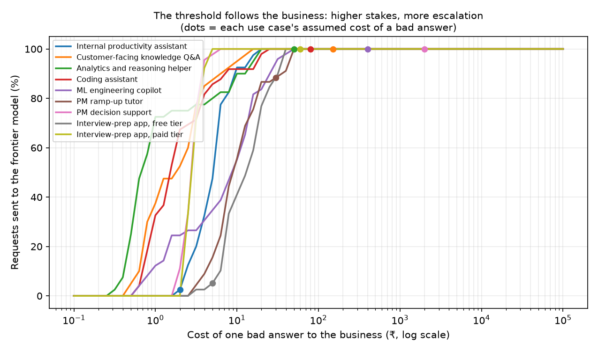
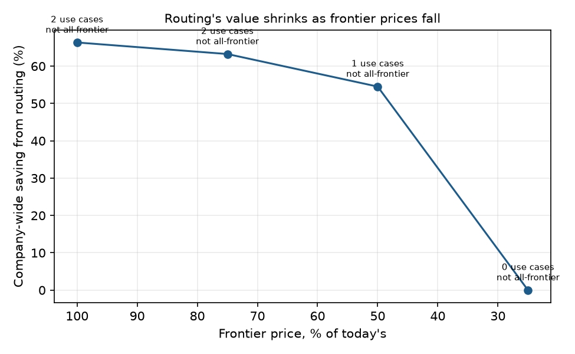
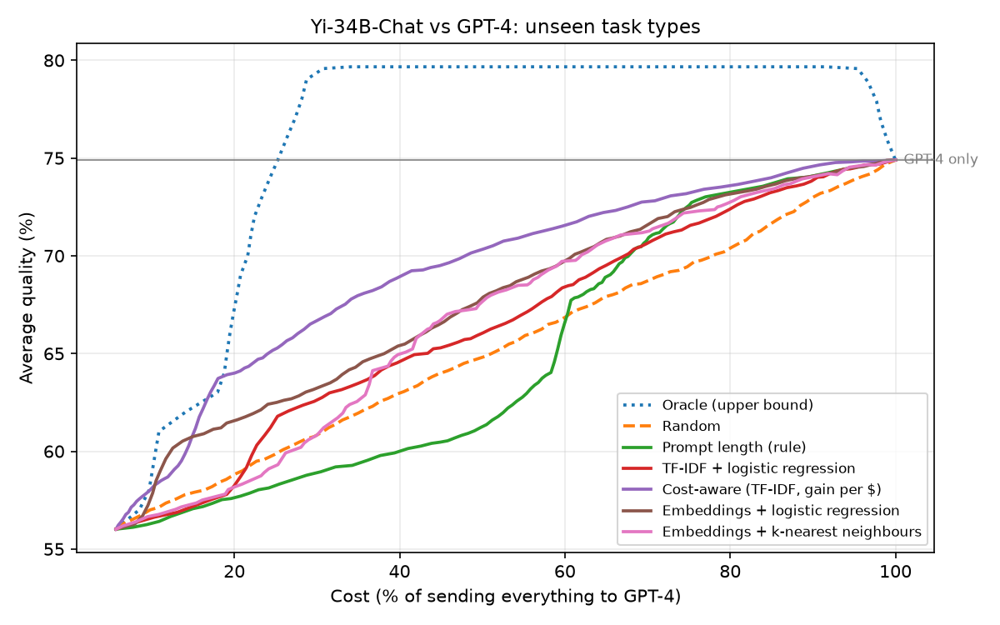

# LLM Routing Policy

**When should an AI product use a cheaper model, and when isn't it worth the risk?** A data-driven answer per business use case, tested on my own real AI work.

Most teams frame model routing as "send easy prompts to a cheap model to save money". I tested that idea three ways: on **my own real work with Claude Opus 5.5**, on **350 prompts spanning nine business use cases**, and on a **36,000-prompt public benchmark**. The answer is more interesting than "routing saves X%":

- **Savings are real but concentrated.** Only high-volume, low-stakes use cases (internal rewrites, a free consumer tier) should default to a cheap model. Because they carry most of the traffic, a company with nine AI use cases still saves **~66%** at today's prices.
- **For judgement-heavy work, the frontier model is the rational choice.** A frontier answer costs ~₹1–3, so once a bad answer costs more than roughly ₹1–12, escalating wins.
- **Verification beats prediction.** Code checked by unit tests: same quality as all-frontier at **64% lower cost**. A cheap model checking its own answers caught only **0–57%** of its mistakes.
- **The arbitrage is shrinking.** If frontier prices fall to a quarter of today's, the optimal saving drops to **0%**. The durable value is governance, verification and capacity.

📄 **Read:** [Strategy & exec memo](docs/STRATEGY.md) · [Decision records per use case](docs/DECISIONS.md) · [PRD](docs/PRD.md)



---

## Why this exists

I pay about ₹2,300 a month for AI subscriptions and regularly hit usage limits. My requests are a real mix: complex, strategic work (product decisions, positioning, evaluation design) alongside smaller, simpler ones (rewrites, explanations, quick questions). But because I use the same frontier model for everything, the simple requests consume the same scarce capacity as the hard ones.

Switching to a smaller model for some of that work only makes sense with **confidence that it's as good as the frontier model for that kind of task**. *Which* kinds of task, at what risk, and how would a team decide? That's what this project tests. Companies face the same question at much larger scale on their API bills.

## 1. Shadow test on my own work

Claude Opus 5.5 did **111 real tasks** across two of my projects (this one and an AI resume-screening app). Its replies were accepted and built on, so they serve as the reference. I then:

1. **Measured where the usage went.** **93%** of it came from agentic build work (editing files, running commands) that re-reads long contexts; question-style requests were only ~7%.
2. **Replayed the 36 question-style requests on smaller models** and had them judged blind against Opus's replies:

| Small model and context given | Met my need | As good as Opus |
|---|---|---|
| Claude Haiku 4.5, short excerpt (~700 characters) | 39% | 8% |
| Claude Haiku 4.5, recent conversation (~12,000 characters) | 47% | 8% |
| Qwen 2.5 3B (local, free; 33 judged) | 6% | 3% |

**Takeaways:** my work was mostly PM and strategy judgement, which small models handle poorly, so Opus was the right default. More context helped Haiku but didn't close the gap. Routing has to happen **at task or session boundaries**: this session alone outgrew Haiku's context window. For a heavy user, the capacity lever is **context hygiene** (fresh sessions, compaction), worth an estimated **+32% more work per usage window**, versus +4% from routing questions.

At API list prices, that 4-day build sprint was worth about **$300**, which is **29–57× my monthly subscription**. For heavy users, subscriptions are the bargain, and routing buys *capacity*, not money.

## 2. Nine business use cases: the decisions

350 prompts across eight kinds of work: public benchmarks with objective answers (GSM8K, HumanEval, MBPP, MMLU, Dolly) plus 205 realistic prompts written for PM, AI/ML engineering, interview-prep and software personas. Every prompt was answered by Claude Opus 5.5, Claude Haiku 4.5 and Qwen 2.5 3B (Alibaba's open-weight model, run free on my laptop via Ollama), then graded with **unit tests and answer keys** where possible and a **blind AI judge** otherwise.

Each use case has stated business inputs (the cost of a bad answer, a quality floor, volume, a latency budget), and the decision engine picks the strategy with the lowest *expected total cost*: API cost plus (share of bad answers × the cost of a bad answer), among those that meet the floor.

| Use case | Cost of a bad answer | Floor | **Recommended** | Saving vs all-frontier |
|---|---|---|---|---|
| Internal productivity (rewrites, summaries) | ₹2 | 85% | Answer cheaply, verify, escalate failures | **58%** ⚠️ |
| Interview-prep app, free tier | ₹5 | 80% | Always the cheap model | **91%** ⚠️ |
| Customer-facing knowledge Q&A | ₹150 | 95% | Always frontier | 0% |
| Analytics and reasoning | ₹50 | 90% | Always frontier | 0% |
| Coding assistant | ₹80 | 90% | Always frontier (tests-based cascade: 64% saving on test-verifiable tasks) | 0% |
| ML engineering copilot | ₹400 | 95% | Always frontier | 0% |
| PM ramp-up tutor | ₹30 | 85% | Always frontier | 0% |
| PM decision support | ₹2,000 | 95% | Always frontier | 0% |
| Interview-prep app, paid tier | ₹60 | 95% | Always frontier | 0% |

⚠️ = **fragile**: the decision flips if the quality floor moves by 5 points. **The quality floor is the input a PM most needs to set explicitly with stakeholders.**

How often the cheap model (Haiku) met the need: maths 92%, coding 88%, knowledge Q&A 82%, rewrites 82%, interview prep 80%, PM explanations 76%, ML engineering 69%; and as good as Opus on PM decisions and interview coaching only **9–13%**.

Full decision records, with every strategy's quality, cost, latency and confidence range: **[docs/DECISIONS.md](docs/DECISIONS.md)**.

## 3. Business impact

| | Monthly cost (base case, 2.25M requests) |
|---|---|
| All-frontier | ₹48.8 lakh |
| Recommended policies | ₹16.4 lakh |
| **Net saving after running costs** | **₹31.2 lakh**, payback on a ~₹3.5 lakh build in days |

The savings come almost entirely from two high-volume, low-stakes use cases, so **validate your volume mix first**. And the case weakens as prices fall:



The strategy, build-vs-buy, go-to-market (the shadow test *is* the sales motion), launch plan and risk register are in **[docs/STRATEGY.md](docs/STRATEGY.md)**.

## 4. Supporting research: the public benchmark

Before the business framing, I tested routing on [RouterBench](https://huggingface.co/datasets/withmartian/routerbench) (36,497 prompts, 11 models). Key results:

- **Routers that learn "which prompts are hard" save calls, not money:** hard prompts are also the expensive ones. Ranking by *expected quality gain per extra dollar* keeps **95% of GPT-4's quality at 65–79% lower cost** (43–48% on unseen task types).
- **Price per token ≠ price per task:** in a live test, Claude Opus 5.5 (4× Haiku's token price) was cheaper per answer than Haiku with thinking on, because Opus adapts how much it thinks.



## How the decision works

> Escalate to the frontier model when **P(cheap answer is bad) × cost of a bad answer ≥ the extra cost of the frontier answer**, then enforce the use case's quality floor.

So the threshold is literally *extra cost ÷ cost of a bad answer*, and it moves with the business stakes. Four strategies are compared per use case: always cheap, always frontier, predict-from-the-prompt routing, and answer-verify-escalate.

## Measurement and reliability

| Check | Result |
|---|---|
| Coding grader | All 40 official reference solutions pass the test harness |
| Benchmark label errors | One wrong GSM8K answer key found and corrected, with a documented note |
| AI judge, position swap | **93%** same verdict with answers reversed (46 pairs) |
| AI judge, independent second judge | **87%** agreement between Sonnet and Opus (60 pairs) |
| First judge design | v1 ("which is better?") never returned a tie, so it was redesigned to "does it meet the need / is the other *materially* better?" |
| Prompt-only predictor | Worse than guessing the average at the "acceptable" bar (Brier 0.210 vs 0.159), which is why use-case policy beats per-prompt prediction |

## Real usage data: measured, kept private

Part of this study was measured on **real usage data**, not only benchmarks: my own Claude Code sessions and my real interview-prep conversations. That data is personal and confidential, so **it is not in this repository**. The aggregate numbers it produced are below, and the code that computed them is included, so anyone can run the same analysis on their own data.

| Real-data slice | What was measured | Result |
|---|---|---|
| My own Claude Code work (2 projects, 111 tasks) | Where usage went | **93%** agentic build work (editing files, running commands); question-style requests only **~7%** |
| 36 question-style requests from that work | Small model judged blind against what Opus actually answered | Claude Haiku 4.5 met the need **39%** (short context) / **47%** (~12k characters of context); as good as Opus **8%**. Qwen 2.5 3B: **6%** / **3%** (33 judged) |
| Same sprint, priced at API list rates | Cost of 4 active days | About **$300**, i.e. **29–57×** my ₹2,300 monthly subscription |
| Same sessions, capacity scenarios | What frees the most usage | Shorter contexts (fresh sessions, compaction): **+32%** more work per usage window, versus **+4%** from routing questions to a smaller model |
| 146 real interview-prep requests | Collected and answered locally by Qwen 2.5 3B | Frontier comparison still to run; not used in the decisions above |

How the privacy split works:
- The 350-prompt evaluation set (`hybrid/dataset.jsonl`) is all public benchmark items or prompts written for this project. Its answers, grades and verification results are published in `results/public/`, and `python -m hybrid.decide` reproduces `docs/DECISIONS.md` from them exactly.
- The full logs, which also contain the private rows, stay local (`data/` and the ignored files in `results/`). `python -m hybrid.export_public` writes the public subset, and `tests/test_privacy.py` fails if a private row, a secret, an email address or a local path ever reaches the repository.

## Run it

```bash
python -m venv .venv && .venv\Scripts\activate
pip install torch --index-url https://download.pytorch.org/whl/cpu
pip install -r requirements.txt
python -m pytest                      # 21 tests, including privacy checks; no API calls or downloads needed

python -m hybrid.build_dataset        # rebuild the 350-prompt dataset (deterministic)
python -m hybrid.decide               # decisions per use case → docs/DECISIONS.md (uses results/public/)
python -m hybrid.economics            # business impact and price scenarios

python download_data.py               # RouterBench (~100 MB), needed for run_benchmark.py and route.py
python route.py "Prove there are infinitely many primes"
```

Collecting answers uses Qwen 2.5 3B locally via [Ollama](https://ollama.com) and Claude through a Claude subscription via the Claude Code CLI (`hybrid/run_models.py`). All answers are cached, Claude calls need an explicit `--yes`, runs are capped, and they stop automatically on a usage-limit message.

| Path | What it does |
|---|---|
| `hybrid/policies.py` | The nine business use cases and their stated assumptions |
| `hybrid/decide.py` | Decision engine: strategies, floors, robustness, calibration, `DECISIONS.md` |
| `hybrid/economics.py` | Personal and company economics, price scenarios |
| `hybrid/grading.py`, `grade.py` | Answer keys, unit-test runner, blind judge, reliability checks |
| `hybrid/verify.py` | Answer-then-verify experiment |
| `hybrid/build_sessions.py`, `shadow.py` | Shadow test on my own Claude Code sessions (data stays local) |
| `hybrid/export_public.py`, `results/public/` | Public subset of answers and grades; private rows left out |
| `router/`, `run_benchmark.py` | RouterBench research: routers, metrics, cost-aware routing |
| `docs/` | Strategy, decisions, PRD |

## Limitations

- About 35–50 prompts per use case: results are directional, shown with 95% confidence ranges.
- Costs are API-equivalent list prices measured through the Claude Code CLI, not invoices; subscription limits aren't published, so capacity estimates use API-equivalent cost as a proxy.
- The business inputs are illustrative assumptions, stated openly so they can be challenged.
- The open-ended grading uses an AI judge, with its reliability measured above; a human review sample is still pending.
- Real usage data (my session transcripts and interview-prep notes) stays local for privacy; only aggregate results are published (see "Real usage data" above).

## Credits

RouterBench (Martian, 2024); RouteLLM (LMSYS, 2024) for the APGR metric; GSM8K, HumanEval, MBPP, MMLU and Dolly-15k for public prompts (see `hybrid/README.md` for licences).

## License

MIT
