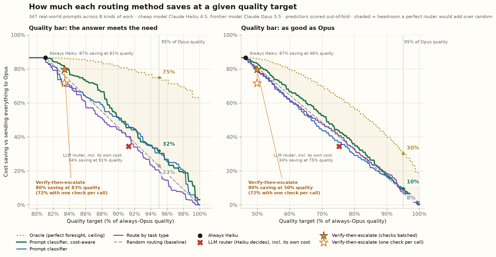
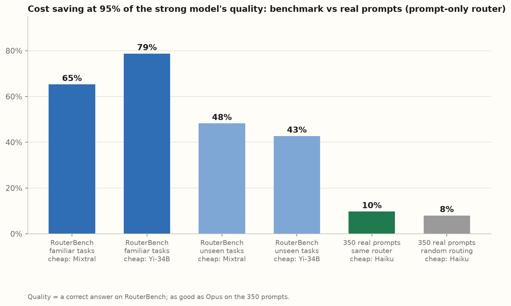
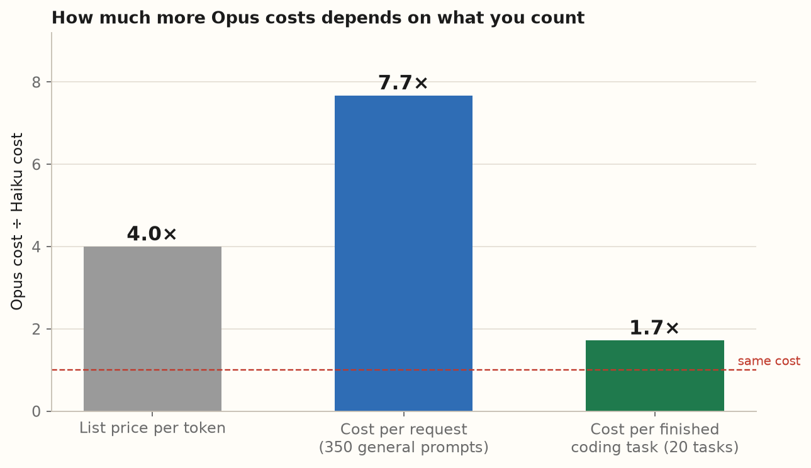
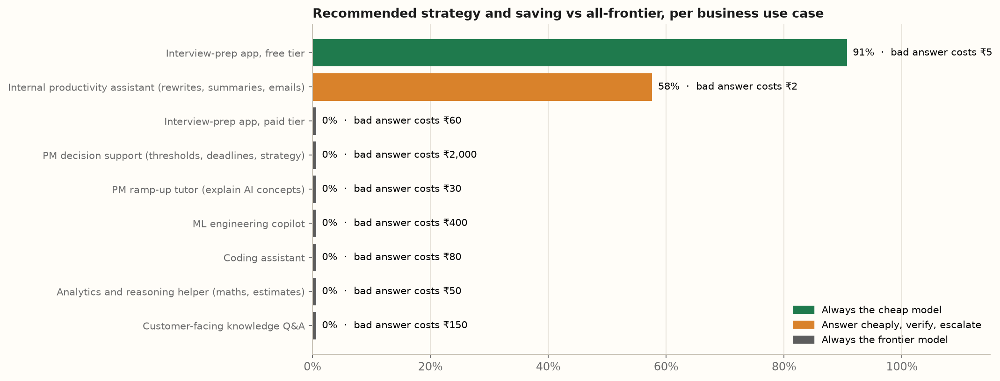
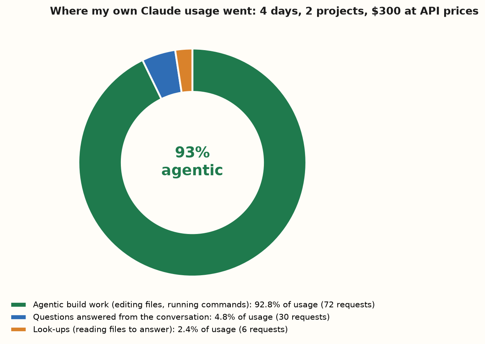

# Experiments: the questions I asked, and what they decided

Each experiment answers one product question. The detail behind every number is in `results/`, and the charts regenerate with `python -m hybrid.charts`.

## 1. Can we tell from the prompt which requests need the big model?

**Why it matters.** Every routing product pitches this: read the request, send the easy ones to a cheap model. If it doesn't work on real traffic, the product needs a different design.

**What I did.** Trained a prompt classifier (and tried an AI model as the router) on a public benchmark and on my 350 real-world prompts, and compared them with random routing and with a perfect router that knows every outcome in advance.

**Answer.** On the benchmark, the classifier kept 95% of the strong model's quality at 65–79% lower cost. On real prompts it saved 10%, against 8% for random routing. Using an AI model as the router was no better and added about 4 seconds to every request. A perfect router could save 30%, so the gap is in predicting, not in the idea.

**Decision.** Don't sell prompt-based routing on benchmark numbers. Check the cheap *answer* instead, where a check exists (section 2), and measure savings on the customer's own traffic before promising any.

## 2. Is checking the answer better than predicting?

**Why it matters.** If the cheap model answers first and something checks the result, only failures cost the big model's price.

**Answer.** For code, unit tests are a reliable check: same quality as always using the frontier model, at 64% lower cost. For open-ended answers, a cheap model checking itself caught only 0–57% of its own mistakes, and the check adds about 5 seconds per request.

**Decision.** Use verify-then-escalate where an objective check exists (tests, schemas, answer keys). Elsewhere, decide per use case (section 4).

## 3. Is the cheap model still cheap once the task is finished?

**Why it matters.** Users pay for finished work, not for single requests. A cheap model that needs retries, or writes longer answers, can cost more.

**What I did.** Gave both models 20 coding tasks with hidden tests and up to four attempts each, counting every attempt.

**Answer.** Both solved every task on the first try. Opus costs 4× Haiku per token and 7.7× per request, but only 1.7× per finished task, because Haiku wrote longer code; on the hardest task Haiku cost more than Opus. With a 7.7× gap per request, Haiku stays cheaper only if it needs fewer than about 7 attempts per task.

**Decision.** Compare models on cost per completed task. The untested case is multi-step agent work, where retries are most likely; that's next.

## 4. Which strategy fits each business use case?

**Why it matters.** A support bot and an internal rewrite tool have very different costs of being wrong.

**What I did.** Gave nine use cases explicit business inputs (cost of a bad answer, quality floor, volume, latency budget) and let the decision rule pick the cheapest strategy that meets the floor.

**Answer.** Only the two high-volume, low-stakes use cases move away from the frontier model, saving 58% and 91%, and both decisions flip if the quality floor moves by 5 points.

**Decision.** The quality floor is the input to agree with stakeholders first. Full records: [DECISIONS.md](DECISIONS.md).

## 5. Would routing help a heavy user like me?

**Why it matters.** I started this because I hit usage limits. If routing doesn't help me, the consumer pitch is weak.

**Answer.** 93% of my usage was agentic build work, not questions. On the questions, Haiku matched Opus only 8% of the time. Shorter contexts would free about +32% more work per usage window; routing questions, about +4%.

**Decision.** For heavy users, sell capacity (context hygiene, routing whole sub-tasks) rather than per-question savings. The bigger market is companies with API bills.

---

## Appendix: the data behind these answers

| Data | Size | Graded by |
|---|---|---|
| RouterBench (public benchmark) | 36,497 prompts, 86 task types, 11 models | answers already recorded |
| My evaluation set | 350 prompts across 8 kinds of work: 145 from public benchmarks (GSM8K, HumanEval, MBPP, MMLU, Dolly) and 205 I wrote for PM, ML, interview-prep and software personas | unit tests and answer keys (105), a blind AI judge (245) checked for consistency |
| My own Claude Code sessions | 111 real tasks over 4 days | kept private; only totals published |
| Coding tasks for the task-completion test | 20 tasks with 268 hidden tests (parsers, scheduling and date rules, business rules, a small template engine) | unit tests |
