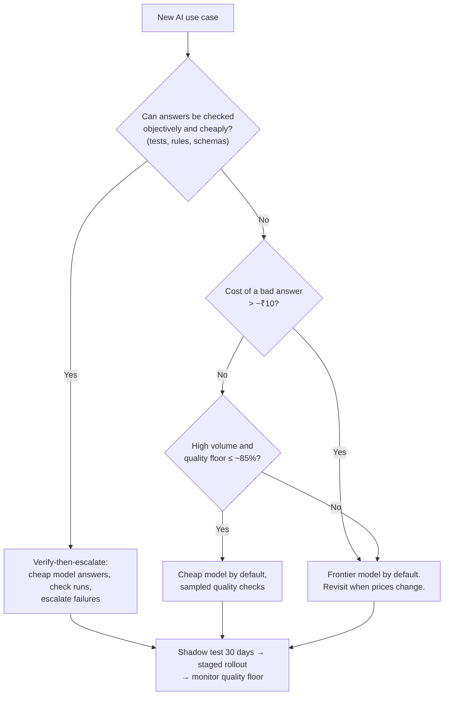
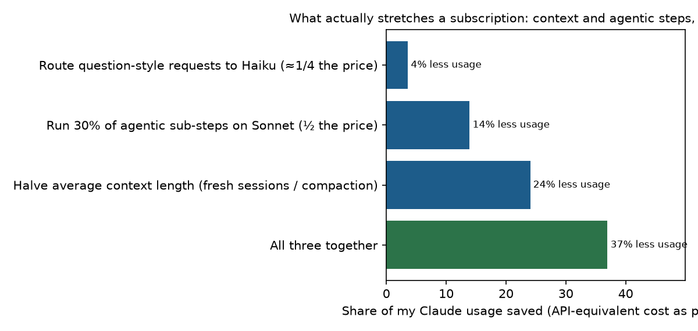

# Strategy: when AI model routing pays, when it doesn't, and what to build

| | |
|---|---|
| **Author** | Kruthi Varanasi |
| **Date** | October 2026 |
| **Evidence** | [Decision records](DECISIONS.md) · [PRD](PRD.md) · numbers from `results/` (generated by `hybrid/decide.py` and `hybrid/economics.py`) |
| **Status** | Recommendation, ready for review |

---

## 1. Executive memo

**Recommendation:** don't build "a smarter model router". Build a **routing policy layer**: decide the model **per use case** from the business cost of a bad answer and an explicit quality floor, **escalate on objective checks** (tests, rules) where answers can be verified, and send everything else to the frontier model. Treat cost-routing as a **time-limited saving** and invest the durable effort in **governance, verification and capacity management**.

**Why (evidence):**
1. **Savings are concentrated, not everywhere.** Across 9 business use cases, only the two that are *high-volume and low-stakes* (internal productivity, a free consumer tier) should route to a cheap model. They carry most of the traffic, so the company-wide saving is still **~66%** at today's prices.
2. **For most use cases the frontier model is the rational choice.** A frontier answer costs about ₹1–3; once a bad answer costs more than roughly ₹1–12, escalating wins. For knowledge Q&A, coding, ML engineering and PM work, the policy is "always frontier" and that decision is **stable** under ±2× changes to the assumptions.
3. **Verification decides whether per-request routing works.** Code checked by unit tests: same quality as all-frontier at **64% lower cost**. A cheap model checking its *own* answers caught only **0–57%** of its mistakes, and close to 0% on PM and ML work.
4. **Predicting from the prompt alone is weak.** The prompt-only predictor was *worse* than guessing the average (Brier 0.210 vs 0.159) at the "acceptable" bar. Fancy per-prompt ML is not where the value is.
5. **Prices are falling.** If frontier prices drop to a quarter of today's, the optimal saving from routing falls to **0%** in our model. The arbitrage is temporary.
6. **It held on my own real work.** In a shadow test on 36 real requests from two projects, Haiku met my need only 39–47% of the time (as good as Opus 8%), and question-style requests were just ~7% of my usage. For a heavy user, the capacity lever is context hygiene, not routing questions.

**Impact (base case, stated assumptions):** ₹48.8 lakh/month all-frontier → ₹16.4 lakh/month with the recommended policies, **₹31 lakh/month net** after running costs, payback in **under a month** on a ~₹3.5 lakh build.

**Biggest risks:** hidden quality loss on routed traffic (mitigate: shadow mode first, quality floors, sampled judging); the decision flips if the quality floor moves (mitigate: set the floor explicitly with stakeholders); provider price cuts erode the case (mitigate: value the layer on governance, not only savings).

**Ask:** agree the quality floors and the cost of a bad answer for each use case (Section 3), then run a **shadow test on 30 days of real traffic** before routing anything live.

---

## 2. What we learned

| # | Finding | Evidence | So what |
|---|---|---|---|
| 1 | Routers that pick "hard" prompts save **calls, not money** | RouterBench, 36k prompts: classifier ≈ random on cost; cost-aware ranking 65–79% saving at 95% of GPT-4 quality | Optimise ₹ per unit of quality, not share of calls |
| 2 | **Price per token ≠ price per task** | Opus 5.5 (4× Haiku's token price) was cheaper per answer than Haiku with thinking on | Judge models on cost per completed task; effort and thinking settings matter as much as model choice |
| 3 | Cheap models are fine for **routine** work, not **judgement** work | 350 prompts: Haiku as good as Opus 80–82% on maths, coding, knowledge; 9–13% on PM decisions and interview coaching | The quality bar ("acceptable" vs "best") is a product decision per use case |
| 4 | **Verification only works when it's independent** | Unit tests: 64% saving, no quality loss; Haiku self-check caught 0–57% of its errors | Invest in objective checks; don't trust self-evaluation |
| 5 | **Use-case policy beats per-prompt prediction** | Prompt-only predictor worse than base rate at the acceptable bar | Start with simple, explainable policies |
| 6 | **Context, not model choice, drives agentic cost** | My own Claude Code work: 93% of usage was agentic build steps re-reading long contexts | For heavy users, context hygiene is the biggest lever |
| 7 | The value of cost-routing **decays with price** | Savings 66% → 55% → 0% as frontier prices fall to 100% → 50% → 25% | Build for governance and capacity, not just arbitrage |
| 8 | **On my own real work, a small model would have failed me more often than not** | Shadow test, 36 real requests: Haiku met the need 39–47% (more context helped), as good as Opus 8% | Judgement-heavy work belongs on the frontier model; route at task boundaries, not per message |

Measurement quality: objective grading where possible (unit tests, answer keys); an Opus judge elsewhere, **93% consistent** with answer order swapped and **87% in agreement** with an independent Sonnet judge.

---

## 3. Routing policy playbook

A decision procedure any team can apply, derived from the evidence above:

The inputs a PM owns, per use case:

| Input | Example values | Who decides |
|---|---|---|
| Quality bar: "acceptable" or "best" | Rewrites: acceptable · PM decision support: best | PM with the business owner |
| Cost of a bad answer (₹) | Rewrite: ₹2 · customer answer: ₹150 · strategy input: ₹2,000 | Business owner, with support or finance data |
| Quality floor | 80–95% | **PM with stakeholders, explicitly.** It is the input most likely to flip a decision |
| Latency budget (p95) | Customer-facing: 10 s · analysis: 120 s | PM with design |
| Volume | Requests per month | Data |

The decision rule behind the playbook: *escalate when P(cheap answer is bad) × cost of a bad answer ≥ the extra cost of the frontier answer*, then enforce the floor. See [DECISIONS.md](DECISIONS.md) for each use case's numbers.

---

## 4. Unit economics

### 4.1 A heavy individual user on a subscription

My own Claude Code work (two real projects, 111 tasks over 4 active days, all on Opus 5.5) is worth about **$300 at API list prices**, roughly ₹6,600 per active day. At 10–20 active days a month that's **₹66,000–1,32,000**, or **29–57× the ₹2,300 subscription**.

So for heavy users the subscription is the bargain, and routing's value is **capacity: more work before the usage limit resets**, not money. What stretches the limit (scenarios, API-equivalent cost as the proxy for limit use):

| Lever | Usage saved | More work per limit window |
|---|---|---|
| Route question-style requests to Haiku (*but the shadow test below shows it would fail my need more than half the time*) | 4% | +4% |
| Run 30% of agentic sub-steps on Sonnet | 14% | +16% |
| **Halve average context length** (fresh sessions, compaction) | **24%** | **+32%** |
| All three | 37% | **+59%** |

**Shadow test on my own work.** Opus 5.5 did 111 real tasks across two projects (this one and SmartHire), and its replies were accepted and built on, so they serve as the reference. The 36 question-style requests (no tools) were replayed on smaller models and judged blind against Opus's replies:

| Small model and context given | Met my need | As good as Opus |
|---|---|---|
| Haiku 4.5, short excerpt (~700 characters) | 39% | 8% |
| Haiku 4.5, recent conversation (~12,000 characters) | **47%** | 8% |
| Qwen 2.5 3B (local), short excerpt (33 judged) | 6% | 3% |

What it shows:
1. **More context helps, but ability is the bigger gap.** Most of my requests were PM and strategy judgement, where the benchmark also found cheap models as good as Opus only 9–13% of the time. Two independent sources agree.
2. **For my work, the frontier model was the right default.** Sending every question to Haiku would have saved about 4.5% of my total usage while failing my need more than half the time. That's a bad trade.
3. **Routing has to happen at task or session boundaries, not per message.** This session alone outgrew Haiku's 200K-token context window, so a small model couldn't take over mid-conversation even if quality allowed it.
4. **Questions are only ~7% of my usage.** The capacity that matters comes from context hygiene and from cheaper models on well-defined agentic sub-steps (table above).

Fairness note: costs are compared as "the small model in the same context" (Opus's real token counts at the small model's prices), so the small model isn't flattered by having seen less context.

### 4.2 A company with nine AI use cases

Base case: 2.25 million requests/month across the nine use cases at the volumes in `hybrid/policies.py`.

| Volume | All-frontier / month | Recommended / month | Net saving after run costs | Payback on ~₹3.5 lakh build |
|---|---|---|---|---|
| 0.25× (≈560k requests) | ₹12.2 lakh | ₹4.1 lakh | ₹7.3 lakh | ~2 weeks |
| 1× (2.25M) | ₹48.8 lakh | ₹16.4 lakh | ₹31.2 lakh | days |
| 4× (9M) | ₹195 lakh | ₹65.6 lakh | ₹126.7 lakh | days |

Run costs = a quarter of an engineer to own thresholds and evals, plus judging 2% of traffic (≈₹1.16 per check). **Where the money comes from:** two high-volume, low-stakes use cases. If those volumes were small, the saving would be small. **Validate the volume mix first.**

---

## 5. Strategy over time: the arbitrage is shrinking

| Frontier price vs today | Company saving from routing | Use cases still routed |
|---|---|---|
| 100% | 66% | productivity, free tier |
| 75% | 63% | productivity, free tier |
| 50% | 55% | free tier |
| 25% | **0%** | none |

Frontier prices for a given capability have been falling, and newer frontier models adapt their effort (finding 2). The pure cost argument for routing therefore weakens over time. **Durable value** sits in:
1. **Governance:** explicit quality floors, audit trails of which model answered what, policy per use case.
2. **Verification:** objective checks that let cheap answers ship safely and catch regressions.
3. **Capacity management:** staying within rate limits and subscription limits at peak.
4. **Provider independence:** switching models without rewriting products.

---

## 6. Build vs. buy

| Option | Strengths | Weaknesses | Fit |
|---|---|---|---|
| **Gateway with routing** (e.g. OpenRouter-style marketplaces, provider gateways) | Fast, many models, little engineering | Generic policies; quality evidence on *your* traffic is limited; another vendor in the data path | Early teams, prototypes |
| **Specialist routers** (e.g. Martian, Not Diamond) | Learned routing, research depth | Optimise "best model per prompt", which isn't the same as "cost at our quality floor"; data leaves your stack | Teams with large, varied traffic |
| **Open-source** (e.g. RouteLLM) | Free, inspectable | You own evals, ops and updates | Teams with ML capacity |
| **In-house policy layer** (this proposal) | Business-owned floors, verification tied to your workflows, privacy | Engineering and ownership cost | Teams where a few use cases dominate volume |

**Recommendation:** start in-house with the **simple policy layer** (use-case defaults plus verification). It's cheap to build because the logic is simple, and it keeps quality decisions with the business. Re-evaluate specialist routers only if traffic becomes highly varied *within* use cases.

---

## 7. The product version: go-to-market

**Ideal customer:** Indian SaaS and consumer-tech companies spending ₹10 lakh+/month on LLM APIs, with at least one high-volume, low-stakes AI feature.

**Wedge: the shadow audit.** *"Give us 30 days of anonymised logs. We'll replay them in shadow mode against cheaper models and show the saving at your quality floor, before you change anything."* This project *is* that audit, run on my own work. It's low-risk for the buyer and turns the sales conversation into evidence.

**Pricing:** a share of measured savings in year one (no saving, no fee), then a platform fee for governance and monitoring once the arbitrage shrinks (Section 5).

**Positioning:** *"Routing policy you can defend: per-use-case quality floors, verified cheap answers, and proof on your own traffic."* Not "the smartest router".

---

## 8. Launch and governance

**Rollout:** shadow (0% live, 2–4 weeks) → 5% → 25% → 100% per use case. Advance only if the quality floor holds in sampled judging and user signals (regenerations, complaints, escalations) don't worsen.

**Ownership:** the PM owns the policy table (bar, cost of a bad answer, floor, latency). Engineering owns the gateway and checks. A monthly review re-checks floors and costs, and a review is also triggered by any model or price change.

**Kill switch:** each use case can revert to "always frontier" in one config change. Automatic revert if the sampled quality falls below the floor for 2 consecutive days.

**Metrics:**

| Type | Metric |
|---|---|
| North star | ₹ saved per month **at or above** each use case's quality floor |
| Inputs | Share routed per use case; verification pass rate; escalation rate |
| Guardrails | Sampled quality vs. floor; p95 latency vs. budget; user regenerations and complaints; cost of judging |

---

## 9. Risk register

| Risk | Likelihood | Impact | Mitigation |
|---|---|---|---|
| Hidden quality loss on routed traffic | Medium | High | Shadow first; sampled judging against the floor; auto-revert |
| Decision flips if the floor shifts (seen in 2 use cases) | High | Medium | Set floors explicitly with stakeholders; document the trade-off |
| Volume mix differs from assumptions | Medium | High | Measure real volume per use case before committing |
| Judge bias (Opus judging Opus) | Medium | Medium | Swap and cross-judge checks (93% / 87%); human review of a sample |
| Frontier price cuts erase the saving | High (over time) | Medium | Value the layer on governance and capacity, not only cost |
| Self-verification gives false confidence | High | High | Use only independent, objective checks for escalation |
| Privacy: routing layer sees all prompts | Medium | High | Self-hosted; metadata-only analytics; no raw prompt storage by default |

---

## 10. Limitations, and what would change this recommendation

- Per-use-case samples are ~35–50 prompts; numbers are directional (95% confidence ranges in DECISIONS.md).
- Costs are API-equivalent list prices measured through the Claude Code CLI, not invoices.
- Business inputs (costs of bad answers, floors, volumes) are illustrative assumptions.
- The personal capacity scenarios use API-equivalent cost as a proxy for subscription limits, which aren't published.

**We'd revise the recommendation if:** a cheap model closes the gap on judgement-heavy work; an independent, cheap verifier proves reliable for open-ended answers; or real traffic shows that low-stakes volume is a small share of the total.
